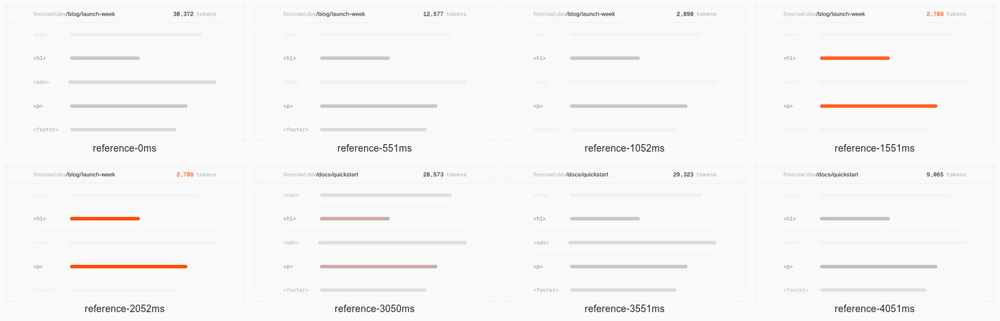
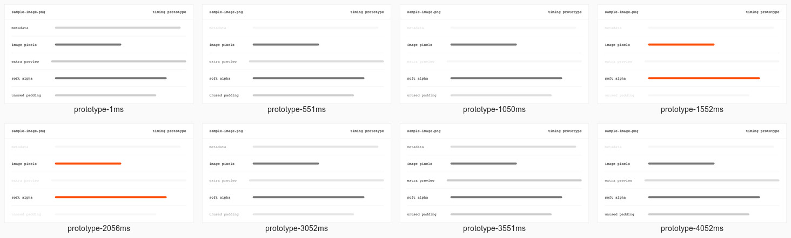

# Firecrawl animation study

Studied 15 October 2026. Selectors and chunk names describe that day's public site.

Firecrawl does not run one master animation. Its decoration, product demonstrations,
text transitions, and interface feedback use separate clocks. Much of the textured
art is a sequence of text frames painted on a Canvas 2D context. The large hero
grid also uses a Pixi renderer. Moving everything onto a GPU shader would miss
both the product storytelling and the reference's browser fallbacks.

The confirmed openBGremover failure was narrower than a universally broken
animation: the deployed shader moved in Chrome when WebGPU was available, but
its canvas stayed invisible when `navigator.gpu` was absent. The replacement
field uses Canvas 2D, keeps the existing layout, and works in that failing case.

## Evidence and scope

Numbers below carry their evidence category:

- **clock**: live browser probes or capture configuration.
- **source**: inspected public bundles or our implementation.
- **media**: parsed frame data, without executing downloaded bundles.
- **frames**: browser screenshots.

The survey covered the homepage and the linked Search, Scrape, Crawl, Interact,
Parse, Monitor, Pricing, Playground, Use Cases, and Alexandria pages. This is a
survey of those marketing and product pages, not an assertion that every article,
authenticated screen, hover state, or experiment on the domain was visited.

Homepage stages were recorded for 32 seconds at a nominal 50 ms sampling interval
**[clock]**, with separate holds at the hero, document parser, loading sequence,
source-routing sequence, coverage illustration, and activity feed. The cleanup
sequence received fresh-start probes on desktop and phone. Initial exploratory
runs scrolled the whole page first; those runs are useful for discovery but were
excluded from final timing comparisons because the warm-up advanced some clocks.

| Page | Canvas elements at initial inspection [clock] | What this inventory establishes |
| --- | ---: | --- |
| Homepage | 34 | Several decorative layers, animated icons, and independent product stages |
| Search | 8 | Shared canvas decoration and a search-oriented demonstration |
| Scrape | 14 | Shared decoration and source-to-output presentation |
| Crawl | 11 | Shared decoration and many separate native animation objects |
| Interact | 10 | Browser/action presentation and shared decoration |
| Parse | 7 | Document-oriented presentation and shared decoration |
| Monitor | 3 | Monitoring presentation with fewer canvas layers |
| Pricing | 12 | Shared decoration plus pricing interactions |
| Playground | 10 | Input controls and shared visual components |
| Use Cases | 6 | Shared decoration and application examples |
| Alexandria | 5 | A separate large architectural ASCII canvas |

These are DOM counts, not counts of distinct animations. Hidden responsive
variants and lazy canvases are included. An initial canvas can still have its
browser-default backing size before its lazy frame module loads.

## Animation inventory

| Family / stage | Actors and sequence | Clock and motion evidence | Carryover to openBGremover |
| --- | --- | --- | --- |
| Hero grid, `#hero-content > canvas` | Bordered cells flash; randomly chosen cells trigger secondary effects. No people or conversation. | Pixi component; randomized visible timers up to 3000 ms, initial ring passes spaced 150 ms, short cell pulses of 30 ms **[source]**. There is no fixed whole-grid loop. | Optional decoration. Do not make the page depend on GPU availability. |
| Mirrored hero ASCII art | Two canvas views paint the same text frame, clipped and mirrored by layout. | 48 frames **[media]**, 85 ms per frame **[source]**, nominal 4080 ms repeat **[media + source]**. Discrete frame replacement, not a morph or easing curve. | Use our own generated glyph geometry or licensed assets. |
| Section backgrounds | Large grey ASCII textures behind section headings. | Separate loaders and intervals, including 75 and 80 ms **[source]**. Their clocks are independent of nearby product demos. | A quiet background can continue without implying processing activity. |
| Explosion near the hero | ASCII burst grows, holds, then replays. | 25 frames **[media]**. Timer is 40 ms; first traversal advances two frames per tick, later traversal one. Negative frame indices implement the hold **[source]**. This is not a constant-speed loop. | Avoid copying a flame burst for an image API. |
| Core flame / icon | Small flame-like ASCII detail accompanies performance sections. | 20 frames **[media]**, 80 ms interval **[source]**, nominal 1600 ms repeat **[media + source]**. | A small original media mark could use the same restrained role. |
| Platform flame | Independent ASCII illustration behind integration content. | 37 frames **[media]**, 60 ms interval **[source]**, nominal 2220 ms repeat **[media + source]**. | Decoration only; it does not establish supported integrations. |
| Active operation icons | Small canvases switch between selected color and inactive grayscale. | Selection classes and native transitions were observed **[clock]**. Some icon appearances are animated independently of labels. Exact frame sequence is unverified. | Preserve selected and disabled states. |
| Hero result / code panels | A browser-like panel, processing indicator, highlighted target, and output representation. | DOM and native animation objects captured **[clock]**. The busy label scrambles on an 80 ms timer **[source]**. No end-to-end request is demonstrated by this decorative sequence alone. | Animate a labelled example; never present a fabricated successful API result. |
| Code language switching | Existing laid-out source changes through scrambled characters, then settles. | String transformation and Motion-based transitions in public bundles **[source]**. It is not ordinary character-by-character typing. | Our existing code switch already uses this mechanism. It was not the reproduced failure. |
| Customer strip | A repeated group of customer marks moves horizontally. | Repeated DOM groups **[clock]**, horizontal presentation **[frames]**. Exact duration unverified. | Do not borrow customers or imply adoption. |
| Reliability bars | Bars grow toward their displayed results. | 5000 ms duration; delay depends on the result; cubic-bezier(.25,.1,.25,1) **[source]**. | Only with our own defensible measurements. |
| Activity feed, `.core-fast` | A new row pushes prior rows down; values and paths vary. | New row every 800 ms; row height expands over 800 ms with linear easing **[source]**. Random values prevent a fixed content loop. | A fabricated live request feed would misrepresent usage. |
| Cleanup card | Unwanted rows dim in order, useful rows gain accent color, then everything resets. | 500 ms step, 500 ms opacity transition using CSS `ease`, 3500 ms visual loop **[source + clock]**. Full beat table below. | A clear before/action/after pattern; demonstration remains separate from production. |
| Repository card | Commit rows and contributor imagery form a product-like proof panel. | DOM/visual inventory **[clock + frames]**. A dedicated repeat clock was not isolated. | Use actual repository information. |
| Document parsing, `.features-media` | Stacked document windows, scan line, extension change, structured output, completion, next document. | Scan positions are an authored list; source format ticks at 110 ms, output JSON ticks at 50 ms; scan-line fade is 100 ms `easeInOut`; card stack uses a spring with stiffness 100 and damping 20 **[source]**. | Useful sequence for a real image-to-output example, but document parsing is not our product. |
| Loading demo, `.features-wait` | Page shell loads, placeholder content fills, status changes, completed panel moves away and the next one arrives. | Status advances every 2500 ms; active spinner uses 700 ms linear turns; card layout uses the same stiffness-100/damping-20 spring **[source]**. Text scrambles before settling **[clock]**. | Tie real status text to real request states. |
| Network routing | User, processing node, connectors, and two destination symbols exchange pulses. | Connector traversal 400 ms linear; node pulses 500 ms; shakes 200 ms. Destination orbit is 32000 ms with playback-rate ramps **[source]**. | Do not imply a cache, global routing network, or durable queue we do not have. |
| Coverage, `.features-stealth` | An orange object crosses concentric rings; ring and icon states change. | Main travel 1000 ms with cubic-bezier(1,0,1,.7), random next direction after 2000 ms; ring orbit 15000 ms linear **[source]**. | Decorative coverage claims do not transfer to image quality. |
| Source routing, `.features-fair-sourcing` | Request, provider route, extraction, and final attributed data states. | Three 2000 ms states and a 3000 ms final state, nominal 9000 ms cycle **[source]**. Status text uses scrambling; state changes confirmed in DOM **[clock]**. | Use the sequencing discipline, not claims about data partnerships. |
| Action lists / use-case panels | Selected action or application changes the displayed product illustration. | State-dependent classes and Motion components **[source]**. Exhaustive input-triggered timing was not isolated. | Keep interaction results tied to the selected operation. |
| Metric counters | Values count toward final text when visible. | 1400 ms, cubic-bezier(.16,1,.3,1), once-only visibility trigger with margin `-10% 0px`; reduced motion skips counting **[source]**. | Avoid invented savings, latency, or adoption metrics. |
| Alexandria architecture | Large architectural ASCII imagery has independent layers and its own clock. | Separate canvas/DOM rendering code and 220 ms visible intervals **[source]**. Full spatial interaction sequence unverified. | Different subject and visual scale; no direct reuse proposed. |
| Navigation, tabs, dropdowns, copy, FAQ | Input-triggered transitions rather than autonomous demonstrations. | Header padding transition 200 ms `ease` **[clock]**. Other transitions depend on the component; no shared global duration exists. | Preserve keyboard operation and immediate readable states. |

The source also contains text-frame sets of 6, 14, 24, 25, 26, 30, and 45 frames
**[media]**. Some are shared by multiple pages. A frame count alone does not
identify a visible stage or establish its loop duration.

## Cleanup stage, cast, and full loop

The cast consists of a title/count bar and five document rows **[source]**.
The first, third, and fifth rows are classified as removable; the second and
fourth are retained **[source]**. They are DOM nodes and bars, not video, Lottie,
Rive, or people. The count tween is a separate Motion animation driven by the
same state step. Each group of steps advances the displayed example path, so
the visual row loop repeats before all text content repeats.

A fresh load's first pass starts with every row visible. Subsequent passes begin
with a restore transition. Times below are relative to a state-cycle boundary.

| Start → end [source] | Actor | Beat |
| --- | --- | --- |
| 0 → 500 ms | All rows | First pass holds the initial state. Later passes restore removable rows from opacity .16 to 1 using `ease`. |
| 500 → 1000 ms | First removable row | Fade from 1 to .16. Count animates to the next value over 350 ms. |
| 1000 → 1500 ms | Second removable row | Same fade and count change. |
| 1500 → 2000 ms | Third removable row | Same fade and count change. |
| 2000 → 3500 ms | Retained rows | Accent color indicates the completed selection. The result remains readable. |
| 3500 ms | Entire stage | Next cycle begins, with a different example path after the reset. Count restores over 500 ms. |

The complete path-content cycle is 14000 ms, comprising four visual cycles
**[source]**. The opacity comparison deliberately measures the 3500 ms visual
cycle **[source]**, not the differing copy.

The original prototype is [media-cleanup-motion.html](prototypes/media-cleanup-motion.html).
It uses illustrative media labels and explicitly says it does not perform a
compression operation or demonstrate measured savings. Its `render(t)` controls
row opacity from one loop time and evaluates the CSS ease curve. It uses no
Firecrawl code, illustrations, videos, frame data, or branding.

## Offscreen, reduced motion, seam, and phone

**Offscreen.** The shared visible-interval helper uses an intersection threshold
of .01 **[source]**. It clears and recreates an interval without resetting the
component's step. The cleanup away run scrolled out after 2500 ms for 4000 ms
**[clock]**. Step advancement stopped while away. Native CSS transitions already
started can finish while the card is offscreen. The prototype freezes its whole
clock, including an in-progress fade. This is an intentional behavioral
improvement, so offscreen fades are not claimed to be identical.

ASCII frame loading begins within a `200px` observer margin **[source]**. The
flame timer wrapper pauses on hidden documents and reduced-motion changes
**[source]**. These guarantees do not apply to every animation on the site:
the generic interval helper defaults to continuing in hidden tabs, and its
one-shot timeout helper disconnects after visibility detection **[source]**.
The Pixi hero explicitly sets `smartStop: false` **[source]**.

**Reduced motion.** The reference cleanup sequence continued to change in a
6500 ms reduced-motion capture **[clock]**. Its probes recorded 22, 20, and 20
distinct opacity values **[clock]**. The prototype's corresponding run recorded
one value per probe and zero animation mutations **[clock]**. The new production
pixel field is also still under reduced motion, including when that preference
changes while the page is open **[clock]**. Do not copy the reference's gaps in
accessibility behavior.

**Seam.** The cleanup seam deliberately restores dimmed rows. It is a reset,
not an invisible last-frame/first-frame match **[source + frames]**. ASCII frame
sequences wrap to their first frame **[source]**; exact last/first-frame similarity
of every artwork is unverified. Randomized grid effects have no fixed seam.
Our procedural field has a 12000 ms period composed of whole sine periods
**[source]**, so its computed geometry agrees at the cycle boundary.

**Phone.** At 390 px **[clock]**, the reference hides the large hero grid and
mirrored hero ASCII layer **[source + frames]**. The cleanup card retains its
row sequence and opacity timing **[clock]**. The prototype keeps that sequence
and reduces spacing. The production field remains available on phone; local
checks found no horizontal page overflow at 390 px **[clock]**.

## Timing comparison

Both sites were sampled at 50 ms with `SYNC=nav`, using opacity probes named
`nav`, `ads`, and `footer` **[clock]**. Those names describe the reference's
removable rows; the prototype uses different visible labels.

| Width [clock] | Probe [clock] | Transition count, reference / prototype [clock] | Largest start gap [clock] |
| --- | --- | --- | --- |
| 1440 px | nav | 4 / 4 | 0 ms |
| 1440 px | ads | 6 / 6 | 0 ms |
| 1440 px | footer | 6 / 6 | 0 ms |
| 390 px | nav | 4 / 4 | 0 ms |
| 390 px | ads | 6 / 6 | 0 ms |
| 390 px | footer | 6 / 6 | 0 ms |

These fresh-start recordings lasted 11000 ms **[clock]** and pass the skill's
100 ms edge tolerance, the 50 ms interval plus 50 ms allowance **[clock]**.
The edge tool groups uninterrupted changing samples; a reset that immediately
reverses direction can appear as one edge. It does not prove every internal
turning point is exact.

The prototype is not pixel-identical. Visibility-masked opacity gaps reached .23
on desktop and .26 on phone for the first row, and .10 and .13 for the other
rows **[clock]**. A one-sample, 50 ms phase adjustment reduced the first row's
largest gap to .13 on desktop and .11 on phone **[clock]**. The reference's CSS
transitions and JavaScript interval clock acquire different frame phases from
the prototype's RAF clock. For scale, the maximum slope of the chosen ease
curve is approximately 2.29 **[source, calculated]**; over a 500 ms fade with
an opacity range of .84, 50 ms can account for about .19 opacity difference
**[source, calculated]**. The raw .26 gap exceeds that single-sample bound, so
it is recorded as a remaining value mismatch, not rounded away as a perfect
match. The matched beat order and edge counts are the validated result.

## Contact sheets

Labels give capture time after bringing the stage into view **[frames]**.
They are visual confirmation; the probe runs above determine timing.






## What makes the reference work

The animated objects look like the product's inputs and outputs. The action
changes a specific object, then leaves the result visible long enough to read.
Textural art moves on another clock and does not pretend to be job progress.
Small fades and restrained motion let the data transformation remain legible.
The strongest carryover is that clear transformation, not flame imagery or
animated performance claims.

For this project, the real uploader and processing state remain the hero's
functional demonstration. The comparison slider already shows a genuine stored
background-removal result. A future automatic comparison could act on that
labelled example, provided it yields to pointer and keyboard input. No such
new product behavior is included in this fix.

## Implemented fix and verification

`PixelField` now starts the small Canvas 2D renderer in `start-pixel-field.ts`.
It has no WebGPU requirement or shader download. The original shader files remain
in the checkout. The renderer caps drawing at 30 fps and backing scale at 2
**[source]**. It cancels its RAF while offscreen, while the document is hidden,
and for reduced motion. Resize and preference listeners are removed on cleanup.
There is no React state update on each animation frame.

Verified locally:

- The deployed shader passed a moving-pixel check with WebGPU and failed the
  same check with WebGPU disabled **[clock]**.
- The replacement passed both cases at 1440 px **[clock]**.
- At 1440 and 390 px, the replacement moved without WebGPU, stopped offscreen,
  resumed on return, stayed still for reduced motion, and resumed when the
  preference changed **[clock]**.
- A simulated `document.hidden` change stopped rendering and the corresponding
  visibility event resumed it **[clock]**. This exercises the event handler,
  not a measurement of OS background-tab throttling.
- Those browser runs had no page errors or horizontal overflow **[clock]**.
- `npm run check` passed strict TypeScript, Oxlint, and the existing suite:
  71 tests passed, one skipped **[clock]**.
- The default Turbopack production build failed because its CSS helper could
  not bind an internal port, including the elevated retry **[clock]**.
  `npm run build -w @openbg/web -- --webpack` passed **[clock]**.
- `git diff --check` passed **[clock]**.

The initial study above was local frontend verification. The subsequent production
release is recorded below. Neither phase made paid inference requests, changed
accounts, or established an improvement in image quality.

## Reproduction and remaining uncertainty

Raw runs and public bundles are in `/tmp/firecrawl-animation-study/`. They are
scratch evidence, not project dependencies. The skill's `timeline.mjs`,
`storyboard.mjs`, `spans.mjs`, `edges.mjs`, and `masked.mjs` produced the timing
reports. Scratch instrumentation tags the cleanup card by finding its token
label and walking to the containing panel; it does not modify the served site.

Important scratch commands:

```sh
node repro.mjs https://openbgremover.dev
node repro.mjs http://localhost:3002
node verify-local.mjs
node finish-captures.mjs
node edges.mjs out/firecrawl-clean-1440/probes.json out/prototype-clean-1440/probes.json
node edges.mjs out/reference-clean-390/probes.json out/prototype-clean-390/probes.json
node masked.mjs out/reference-clean-390/probes.json out/prototype-clean-390/probes.json nav nav
```

The reproduction scripts import the desktop app's bundled Playwright through
a scratch symlink. They do not add dependencies to this repository. Chrome is
needed for replay. The standalone HTML prototype can also be opened directly,
then scrolled to its stage.

Unverified items remain explicit:

- Every product-page demonstration was inventoried, but not every individual
  interaction or deep-page sequence received a full beat table.
- Randomized effects have no single fixed loop and were not made deterministic.
- No videos were present in the sampled page DOMs **[clock]**. Detached video
  sources were not exhaustively ruled out across all lazy interactions.
- The observed runtime includes Motion, Pixi, Canvas 2D, native Web Animations,
  CSS transitions, and visibility helpers **[source + clock]**. No GSAP, Lottie,
  or Rive runtime was detected in the homepage capture **[clock]**; that does
  not prove their absence from every route.
- Safari and Firefox were not run. Removing the WebGPU gate addresses the
  reproduced capability failure, not a claim of an exhaustive browser matrix.
- Rendering cost and battery usage were not benchmarked. The field is small,
  capped, and pauses, but those properties are not performance measurements.


## Production release, 15 October 2026

Released to [openbgremover.dev](https://openbgremover.dev/) as deployment
`dpl_9eFuv9uqvDoGMcR7unhfHd4cT2gD`. Vercel reports `READY`, the production
target, the custom-domain alias, and no alias error **[clock]**.

The release was assembled from the prior production deployment's exact source
hashes. Only `pixel-field.tsx` and `start-pixel-field.ts` changed. Readback of the
released source manifest confirmed those changes and no removed files; every
other production source hash stayed the same **[clock]**. Unfinished API, UI,
package, and documentation work in the local checkout was not included.

Live Google Chrome checks passed at desktop 1440 × 900 and mobile emulation
390 × 844 **[clock]**, with WebGPU present and deliberately unavailable. Both
the hero and final CTA canvas had visible painted pixels that changed between
samples, paused offscreen, resumed on return, stayed still with reduced motion,
and resumed when that preference changed **[clock]**. Reduced motion also passed
from a fresh page load at both widths **[clock]**. No page errors, failed script
or stylesheet responses, or horizontal page overflow occurred in these runs
**[clock]**. This was browser mobile emulation, not a physical-phone test.

The live code-language animation was also checked at both widths. Switching
languages produced an intermediate scramble, settled to the actual selected
code, and settled immediately with reduced motion **[clock]**. The harness
normalizes the renderer's intentional spaces on blank lines before comparing
code text.

Ignored evidence, screenshots, source manifests, and JSON results are under
`artifacts/deployments/animation-2026-10-15/`. Reproduction scripts are
`/tmp/openbg-animation-production-check/verify.mjs` and `code-motion.mjs`.
The prior deployment `dpl_71GXCajJa1SVuSyeKgwMSxhDUfYX` remains the rollback
reference. No Git commit or push was needed for this release.
